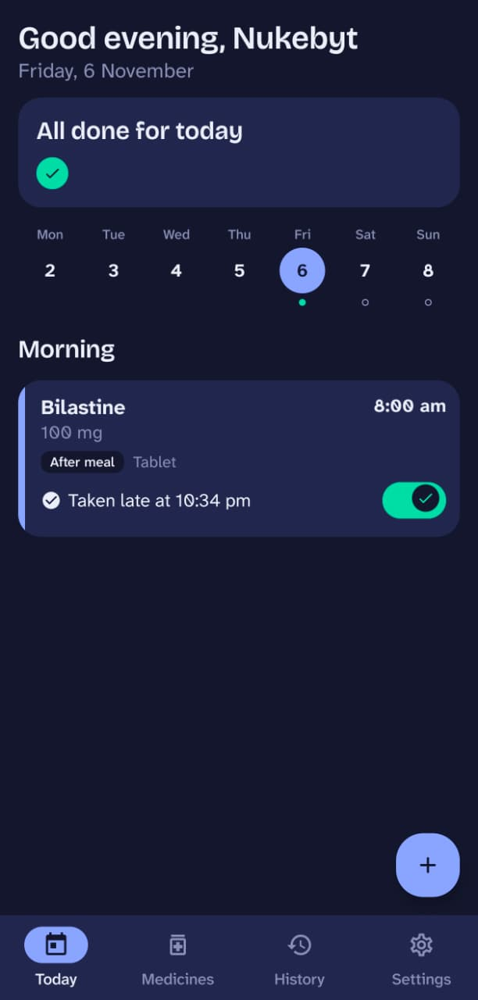
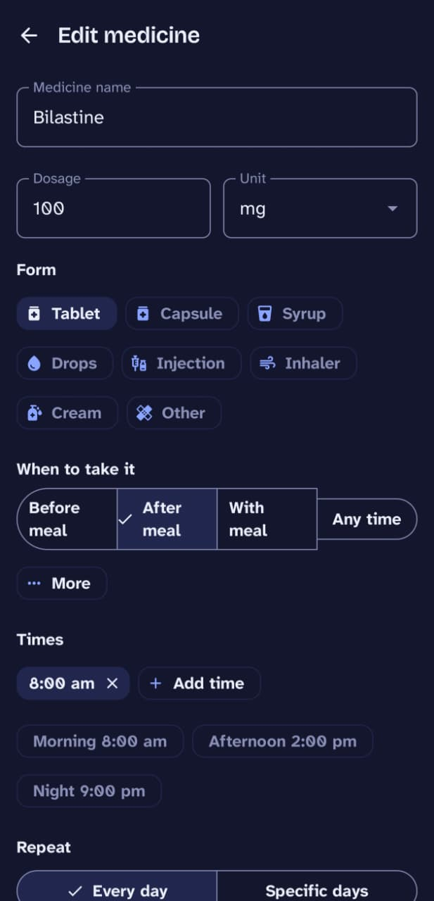
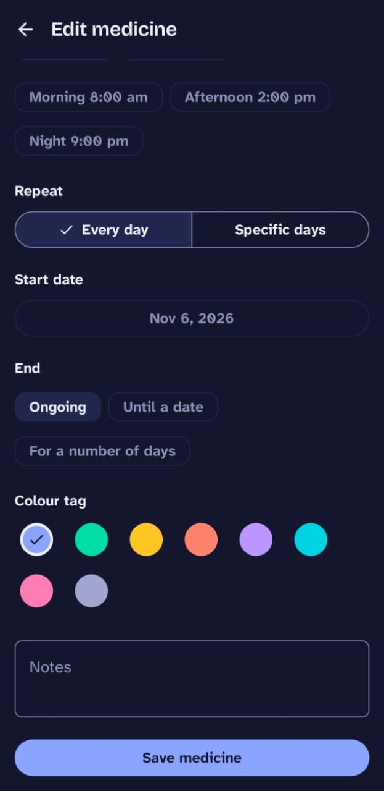
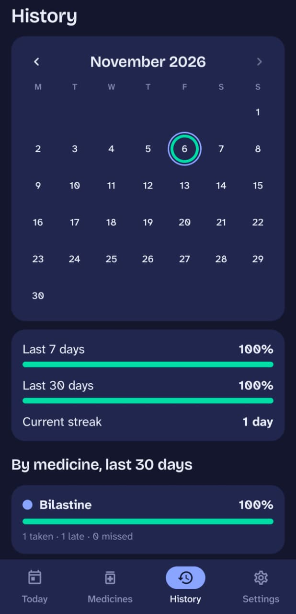

<p align="center">
  
</p>

<h1 align="center">Medicine Reminder</h1>

<p align="center">
  An Android app that makes sure you take your medicine on time.<br>
  Exact-time reminders, an alarm that rings if you ignore them, and a simple record of what you took.
</p>

---

## Screenshots

<p align="center">
  
  
  
  
</p>

| Screen | What it shows |
|---|---|
| **Today** | A greeting with your name, a "blister strip" of today's doses, a week calendar, and one card per dose with a Done toggle. |
| **Add or edit medicine** | Name, dosage, form, meal relation, several daily times, days of the week, start and end date, colour tag and notes. |
| **History** | A month grid where each day is a ring filled by how much you took, plus 7-day and 30-day adherence, your streak, and a breakdown per medicine. |

## Features

- **Medicines:** add, edit, pause and delete. Each has a name, dosage, form (tablet, capsule, syrup and more), a meal relation (before, after, with a meal, empty stomach or any time), one or more daily times, chosen weekdays, start and optional end date, a colour tag and notes.
- **Reminders on the dot:** a notification at the exact time of every dose, with **Taken** and **Snooze** buttons right in the notification. Medicines due at the same time share one notification.
- **Escalation alarm:** if a dose is not marked taken within 5 minutes of the reminder, a looping alarm sounds with vibration and a full-screen alarm screen that appears on the lock screen. **Swipe to stop** silences it. **I took it** stops it and logs the dose.
- **Today screen:** a week strip with tiny dots per day, sections for morning, afternoon, evening and night, and a Done toggle on every dose. Past days can be logged late; future days are read-only.
- **History:** adherence (taken, late, missed), streak, month calendar. Tap a day to jump to it on Today.
- **Survives restarts:** reminders come back after a reboot, a time change, a time-zone change or an app update.
- **Settings:** your name, how long before the alarm rings (1 to 15 minutes, or off), snooze length, alarm auto-stop time, alarm sound, gradual volume, vibration, light, dark or system theme, and a reminder health check.
- **Backup:** export everything to a JSON file and import it again.
- **Private:** no account, no internet permission, no analytics. All data stays on your phone.
- **Accessible:** large-text friendly, TalkBack labels, a "Stop alarm" action for screen-reader users, and status that never relies on colour alone.

## Requirements

- An Android phone or emulator running **Android 8.0 (API 26) or newer**.
- To build it yourself: **Android Studio** recent enough to support Android Gradle Plugin 9.4 (the project is set up for AGP 9.4.0), with the Android SDK 37 platform installed. Android Studio's bundled JDK is fine.

## Download and install

### Quick way: install the APK

1. Open the [latest release](https://github.com/Nukebyt/Medicine-Reminder/releases/latest) on your Android phone and download **Medicine-Reminder-v1.0.apk**.
2. Open the downloaded file. Android will ask you to allow installing apps from your browser or file manager; allow it for this install.
3. Open **Medicine Reminder** and follow the permission steps (see [How to use it](#how-to-use-it)).

This APK is signed with the standard Android debug key, so it is not a Play Store build, and it includes the **Debug tools** section in Settings. Your phone may show a warning about installing from outside the Play Store; that is expected.

### Build it yourself

Prefer to build from source? It takes a few minutes.

#### 1. Get the code

```bash
git clone https://github.com/Nukebyt/Medicine-Reminder.git
```

Or click **Code → Download ZIP** on the GitHub page and unzip it.

#### 2. Open it in Android Studio

1. Choose **File → Open** and select the `Medicine-Reminder` folder.
2. Wait for the Gradle sync to finish (the progress bar at the bottom). The first sync downloads dependencies and can take a while.
3. If Android Studio asks to install a missing SDK platform, accept.

#### 3a. Run on an emulator

1. Open **Device Manager** and create a device: for example **Pixel 8** with an **API 36** system image.
2. Choose that device in the toolbar and press the green **Run** button.

#### 3b. Run on your own phone

1. On the phone, open **Settings → About phone** and tap **Build number** seven times to enable Developer options.
2. In **Developer options**, turn on **USB debugging**, then connect the phone with a cable and allow the prompt on the phone.
3. Pick your phone in the Android Studio device list and press **Run**.

Prefer the terminal? With a phone or emulator connected:

```bash
./gradlew installDebug
```

To make your own APK file, run `./gradlew assembleDebug`. The file is created at `app/build/outputs/apk/debug/app-debug.apk`. Copy it to the phone and open it (you will need to allow installing from that source).

## How to use it

1. **First launch:** the app walks you through four permissions: notifications, alarms and reminders, full-screen alarms, and battery restrictions. Each has a button and a tick when done. Please grant them all, or reminders may arrive late or not at all.
2. **Set your name:** Settings → Your name. It appears in the greeting on Today.
3. **Add a medicine:** tap the **+** button. Enter the name and dosage, choose the form and when to take it, add one or more times (quick buttons for morning, afternoon and night help), pick the days, and tap **Save medicine**. The app tells you when the next reminder is.
4. **When a reminder arrives:** tap **Taken** in the notification, or **Snooze** to be reminded again later.
5. **If you ignore it:** after 5 minutes (configurable) the alarm rings and the full-screen alarm appears. Swipe the handle to the right to stop the sound, or tap **I took it**.
6. **Mark doses on Today:** flip the toggle on a dose card. Taking a dose early means it will not remind you. Switching it off again returns it to upcoming or overdue.
7. **Review your progress:** open **History** to see your month, adherence and streak.
8. **Back up your data:** Settings → Export data saves a file; Import data restores it (this replaces what is currently on the phone).

### If reminders do not arrive on time

Some phone makers (Xiaomi, Realme, Oppo, Vivo, OnePlus, Samsung, Huawei) aggressively stop background apps. Open **Settings → Reminder health check** in the app for steps specific to your phone, and see [dontkillmyapp.com](https://dontkillmyapp.com/). Note that force-stopping the app from Android settings clears all alarms until the app is opened again; this is an Android limitation.

## How it works

Alarms are scheduled **per time slot** (for example 8:00), not per medicine, using `AlarmManager.setAlarmClock`, which is the most reliable exact alarm and still fires in Doze mode. When a slot fires, the app checks which doses are still pending and posts one grouped notification, then schedules the escalation alarm. Marking a dose done from any place (the Today toggle, the notification, or the alarm screen) goes through the same code, which cancels the alarm once nothing in that slot is pending.

Only your actions (taken or skipped) are stored. Whether a dose is upcoming, overdue, taken late or missed is worked out when needed. That keeps the database small and means editing a schedule never leaves stale rows.

The full design and build plan is in [ROADMAP.md](ROADMAP.md).

## Tech stack

Kotlin · Jetpack Compose and Material 3 · Hilt · Room · DataStore · Navigation Compose · kotlinx.serialization · `java.time`. Single `:app` module, MVVM, with a pure-Kotlin `domain` package that has no Android imports.

## Project structure

```
app/src/main/java/com/nukebyt/medicinereminder/
├── alarm/     scheduling, receivers, alarm service and screen, notifications, permissions
├── data/      Room database, repositories, DataStore settings, JSON backup
├── domain/    pure Kotlin logic: dose states, next occurrence, adherence, validation
├── ui/        theme, components, and the Today, Medicines, History, Settings and onboarding screens
└── di/        Hilt modules
```

## Development

```bash
./gradlew assembleDebug             # build
./gradlew testDebugUnitTest         # unit tests
./gradlew connectedDebugAndroidTest # database and UI tests (needs a device or emulator)
./gradlew lintDebug                 # lint
```

The debug build adds **Settings → Debug tools** with "Fire test reminder in 30 s", "Fire test alarm now" and "Show scheduled alarms". To watch the whole reminder pipeline, filter Logcat by the tag `MedicineReminder`.

## Status

All planned features are built. The reminder and alarm behaviour has been tried on an emulator, but it has not yet been tested across many real phones. Expect rough edges and please open an issue if you find one.

## Medical disclaimer

Medicine Reminder is a reminder aid, not medical advice. Follow your doctor's or pharmacist's instructions, and do not double a missed dose without asking them.

## Credits

Made by **Priyanuj Boruah**.

Fonts: [Bricolage Grotesque](https://fonts.google.com/specimen/Bricolage+Grotesque) and [Atkinson Hyperlegible Next](https://fonts.google.com/specimen/Atkinson+Hyperlegible+Next), used under the SIL Open Font License (see the `licenses` folder).

## License

[MIT](LICENSE)
