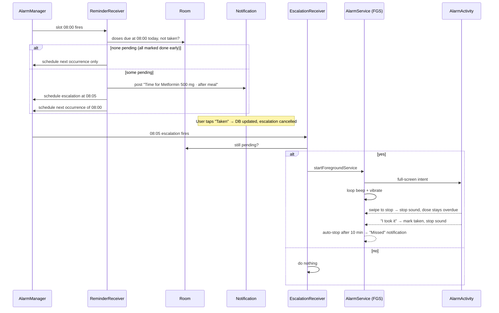

# Medicine Reminder App — Build Roadmap

App name: **Medicine Reminder** (logo: `logo.jpeg` in the repo root). Native Android app, built with VS Code + Claude Code for editing and Android Studio for the emulator, previews and debugging.

Drop this file in the repo root as `ROADMAP.md` and point Claude Code at it phase by phase.

---

## 1. Scope

### MVP (what "fully usable" means)

- Add, edit, pause and delete medicines: name, dosage, form, one or more daily times, meal relation (before / after / with meal / any time), days of the week, start and optional end date, colour tag, notes.
- Exact-time notification for every dose, with **Taken** and **Snooze** actions right in the notification.
- **Escalation alarm:** if a dose is not marked taken within 5 minutes of the notification, a looping beep starts, plus vibration, with a full-screen alarm screen (works on the lock screen). **Swipe to stop.** A separate "I took it" button stops the alarm and logs the dose.
- Home screen with a week calendar strip; tap a day to see that day's doses. Each dose card has a **Done toggle**.
- History with adherence (taken / late / missed).
- Survives reboot, time change, time-zone change, app update, Doze mode.
- Permission onboarding (notifications, exact alarms, full-screen alarm, battery optimisation).
- Light and dark theme, large-text and TalkBack friendly.
- All data stays on the device.

### Not in MVP (see backlog, section 12)

Cloud sync, caregiver alerts, refill tracking, widgets, Wear OS, OCR of prescriptions.

---

## 2. Tech stack and key decisions

| Area | Choice | Why |
|---|---|---|
| Language | Kotlin 2.x | Standard for Android |
| UI | Jetpack Compose + Material 3 (Compose BOM) | Modern, fast to iterate with Claude Code |
| Architecture | MVVM, single `:app` module, packages by layer | Simple enough for one developer |
| DI | Hilt (KSP) | Receivers and services need injected repositories |
| Database | Room (KSP), schema export on | Offline, relational, testable |
| Settings | DataStore (Preferences) | Escalation delay, snooze length, theme, sound |
| Navigation | Navigation Compose (type-safe routes with `@Serializable`) | |
| Time | `java.time` (`LocalTime`, `LocalDate`, `ZonedDateTime`) | minSdk 26 means no desugaring needed |
| Scheduling | `AlarmManager.setAlarmClock()` | Most reliable exact alarm; exits Doze; not rate-limited like `setExactAndAllowWhileIdle` (that one can be throttled to roughly once per 9 min in Doze, which breaks a 5-min escalation) |
| Alarm sound | Foreground service + `MediaPlayer` looping `res/raw/alarm_beep.ogg`, `AudioAttributes.USAGE_ALARM` | Plays on the alarm stream, rings in silent mode, survives the notification shade being opened |
| Alarm UI | Full-screen intent → `AlarmActivity` with `showWhenLocked` / `turnScreenOn` | Lock-screen alarm like a clock app |
| Testing | JUnit5 or JUnit4, Turbine, Room in-memory DB, Compose UI tests | |
| SDK levels | `minSdk 26`, `targetSdk 36`, `compileSdk 36` | Check the current Play target-SDK requirement before release |

> **WorkManager is the wrong tool here.** It is for deferrable work and can be delayed by minutes or hours. Use it only for non-urgent things like nightly cleanup.

---

## 3. How the reminder pipeline works

### Concept: time slots

Alarms are scheduled **per time slot** (e.g. 08:00), not per medicine. When a slot fires, the receiver asks the database which doses are due at that slot today. This gives one grouped notification when three medicines are due at 8:00, and far fewer alarms to manage.

### Flow



### Rules

1. Marking a dose **Done** anywhere (home toggle, notification action, alarm screen) must: update the log, cancel that slot's escalation alarm **if no other dose in the slot is still pending**, and dismiss the notification.
2. Marking a dose done **before** its time is allowed for today. The reminder will then skip it.
3. Un-toggling Done reverts the dose to its derived status (upcoming / overdue). It does not re-ring.
4. Every create / edit / delete / pause of a medicine calls `AlarmScheduler.rescheduleAll()`.
5. Reschedule everything on `BOOT_COMPLETED`, `LOCKED_BOOT_COMPLETED` (optional), `TIME_SET`, `TIMEZONE_CHANGED`, `MY_PACKAGE_REPLACED`, and when exact-alarm permission is granted (`ACTION_SCHEDULE_EXACT_ALARM_PERMISSION_STATE_CHANGED`).
6. A **force stop** from Settings clears all alarms; Android gives no way around this. They come back the next time the app opens (call `rescheduleAll()` in `Application.onCreate`).

---

## 4. Android platform constraints

### Manifest permissions

| Permission | Purpose | Notes |
|---|---|---|
| `POST_NOTIFICATIONS` | Show reminders | Runtime prompt on Android 13+ |
| `SCHEDULE_EXACT_ALARM` | `setAlarmClock()` | Denied by default on fresh installs of Android 14+. Check `alarmManager.canScheduleExactAlarms()`, send the user to `Settings.ACTION_REQUEST_SCHEDULE_EXACT_ALARM` |
| `USE_FULL_SCREEN_INTENT` | Lock-screen alarm | Restricted on Android 14+. Check `notificationManager.canUseFullScreenIntent()`, send the user to `Settings.ACTION_MANAGE_APP_USE_FULL_SCREEN_INTENT` |
| `FOREGROUND_SERVICE` | Alarm service | |
| `FOREGROUND_SERVICE_SYSTEM_EXEMPTED` | FGS type for alarms | Android allows `systemExempted` for apps holding the exact-alarm permission that ring alarms. Fallback: `mediaPlayback` + `FOREGROUND_SERVICE_MEDIA_PLAYBACK`. Verify against current docs before release |
| `RECEIVE_BOOT_COMPLETED` | Reschedule after reboot | |
| `VIBRATE` | Alarm vibration | |
| `WAKE_LOCK` | Keep CPU awake while ringing | |
| `REQUEST_IGNORE_BATTERY_OPTIMIZATIONS` | Optional | Fine for personal use; Play restricts it, so for a Play release just deep-link to battery settings instead |

### Manifest skeleton

```xml
<application ...>
    <activity
        android:name=".alarm.AlarmActivity"
        android:exported="false"
        android:showWhenLocked="true"
        android:turnScreenOn="true"
        android:launchMode="singleInstance"
        android:excludeFromRecents="true"
        android:theme="@style/Theme.MedicineReminder.Alarm" />

    <service
        android:name=".alarm.AlarmService"
        android:exported="false"
        android:foregroundServiceType="systemExempted" />

    <receiver android:name=".alarm.ReminderReceiver" android:exported="false" />
    <receiver android:name=".alarm.EscalationReceiver" android:exported="false" />
    <receiver android:name=".alarm.NotificationActionReceiver" android:exported="false" />

    <receiver android:name=".alarm.RescheduleReceiver" android:exported="true">
        <intent-filter>
            <action android:name="android.intent.action.BOOT_COMPLETED" />
            <action android:name="android.intent.action.TIME_SET" />
            <action android:name="android.intent.action.TIMEZONE_CHANGED" />
            <action android:name="android.intent.action.MY_PACKAGE_REPLACED" />
            <action android:name="android.app.action.SCHEDULE_EXACT_ALARM_PERMISSION_STATE_CHANGED" />
        </intent-filter>
    </receiver>
</application>
```

### Notification channels

| Channel ID | Importance | Sound | Use |
|---|---|---|---|
| `dose_reminders` | HIGH | Short chime | The on-time reminder |
| `dose_alarms` | HIGH | None (service plays the sound) | Escalation FGS notification with full-screen intent |
| `dose_missed` | DEFAULT | Default | "You missed Metformin at 8:00" |

Channel sound and importance cannot be changed after creation. If you change them during development, use a new channel ID or uninstall the app.

### Other platform notes

- **Edge-to-edge** is enforced when targeting SDK 35+/36. Call `enableEdgeToEdge()` and handle `WindowInsets` in every screen.
- **Predictive back** is on by default for SDK 36 targets. Compose Navigation handles it.
- Receivers must finish fast. Use `goAsync()` + a coroutine for any DB work in a `BroadcastReceiver`.
- `PendingIntent`s need `FLAG_IMMUTABLE` (or `FLAG_MUTABLE` only where required).

---

## 5. Data model (Room)

```kotlin
enum class MealRelation { BEFORE_MEAL, AFTER_MEAL, WITH_MEAL, EMPTY_STOMACH, ANY_TIME }
enum class MedForm { TABLET, CAPSULE, SYRUP, DROPS, INJECTION, INHALER, CREAM, OTHER }
enum class DoseStatus { TAKEN, SKIPPED }   // only explicit user actions are stored

@Entity(tableName = "medicines")
data class MedicineEntity(
    @PrimaryKey(autoGenerate = true) val id: Long = 0,
    val name: String,
    val dosageAmount: String,          // "500", "1", "5"
    val dosageUnit: String,            // "mg", "tablet", "ml"
    val form: MedForm,
    val mealRelation: MealRelation,
    val colorIndex: Int,               // index into the palette
    val notes: String? = null,
    val startDate: LocalDate,
    val endDate: LocalDate? = null,    // null = ongoing
    val daysOfWeekMask: Int = 0b1111111, // bit 0 = Monday
    val isPaused: Boolean = false,
    val createdAt: Instant
)

@Entity(
    tableName = "schedule_times",
    foreignKeys = [ForeignKey(MedicineEntity::class, ["id"], ["medicineId"], onDelete = CASCADE)],
    indices = [Index("medicineId")]
)
data class ScheduleTimeEntity(
    @PrimaryKey(autoGenerate = true) val id: Long = 0,
    val medicineId: Long,
    val time: LocalTime                // stored as minutes-of-day via TypeConverter
)

@Entity(
    tableName = "dose_logs",
    foreignKeys = [ForeignKey(MedicineEntity::class, ["id"], ["medicineId"], onDelete = CASCADE)],
    indices = [Index(value = ["medicineId", "date", "time"], unique = true)]
)
data class DoseLogEntity(
    @PrimaryKey(autoGenerate = true) val id: Long = 0,
    val medicineId: Long,
    val date: LocalDate,               // the day the dose belongs to
    val time: LocalTime,               // the scheduled slot
    val status: DoseStatus,
    val actionAt: Instant              // when the user marked it
)
```

### Derived dose state (not stored)

The UI asks for "doses on date D". The repository builds them by combining active medicines × their times, then joining `dose_logs`:

| Condition | UI state |
|---|---|
| Log = TAKEN, `actionAt` ≤ scheduled + 30 min | Taken |
| Log = TAKEN, later than that | Taken late |
| Log = SKIPPED | Skipped |
| No log, scheduled time in the future | Upcoming |
| No log, today, past scheduled time | Overdue |
| No log, a past day | Missed |

Storing only user actions keeps the database tiny and means editing a schedule never leaves orphaned "pending" rows. Put this logic in a pure Kotlin `DoseResolver` so it is unit-testable without Android.

### Key DAO / repository methods

```kotlin
fun observeDosesFor(date: LocalDate): Flow<List<DoseUi>>
fun observeWeekSummary(weekStart: LocalDate): Flow<Map<LocalDate, DaySummary>> // taken/total per day
suspend fun pendingDosesForSlot(date: LocalDate, time: LocalTime): List<DoseUi>
suspend fun markTaken(medicineId: Long, date: LocalDate, time: LocalTime)
suspend fun unmark(medicineId: Long, date: LocalDate, time: LocalTime)
suspend fun allDistinctSlots(): List<LocalTime>   // for the scheduler
```

---

## 6. Project structure

```
app/src/main/java/com/nukebyt/medicinereminder/
├── MedicineReminderApp.kt        // @HiltAndroidApp, channels, rescheduleAll()
├── MainActivity.kt
├── data/
│   ├── db/ (AppDatabase, Converters, entities, DAOs)
│   ├── prefs/SettingsRepository.kt
│   └── repo/MedicineRepository.kt, DoseRepository.kt
├── domain/                       // pure Kotlin, no Android imports
│   ├── DoseResolver.kt
│   ├── NextOccurrence.kt         // next trigger time for a slot
│   └── model/ (DoseUi, DaySummary, ...)
├── alarm/
│   ├── AlarmScheduler.kt
│   ├── ReminderReceiver.kt
│   ├── EscalationReceiver.kt
│   ├── NotificationActionReceiver.kt
│   ├── RescheduleReceiver.kt
│   ├── AlarmService.kt
│   ├── AlarmActivity.kt
│   └── Notifications.kt          // channel setup + builders
├── ui/
│   ├── theme/ (Color, Type, Shape, Theme)
│   ├── components/ (WeekStrip, DoseCard, CapsuleToggle, SwipeToStop, BlisterRow, ...)
│   ├── today/ (TodayScreen, TodayViewModel)
│   ├── medicines/ (MedicineListScreen, EditMedicineScreen, ViewModels)
│   ├── history/
│   ├── settings/
│   ├── onboarding/ (PermissionScreen)
│   └── nav/AppNavHost.kt
└── di/ (DatabaseModule, AlarmModule)
app/src/main/res/raw/alarm_beep.ogg
app/src/main/res/font/ (bricolage_grotesque_*.ttf, atkinson_hyperlegible_next_*.ttf)
app/schemas/                      // Room schema JSON, commit this
```

---

## 7. UI and design spec

### Direction: the blister pack

The design borrows from the physical object everyone recognises: a foil blister strip. Each day's doses appear as pill-shaped cells that "pop" (fill in) when taken. That one motif is the memorable element; everything else stays quiet. It is deliberately different from the reference screenshot (flat greyscale cards, circular day buttons, big-number stat tiles).

### Colour tokens

| Token | Light | Dark | Use |
|---|---|---|---|
| `ink` | `#1B1D3A` | `#ECEEF8` | Primary text |
| `paper` | `#F7F8FC` | `#14162B` | Background (dark is a deep indigo, not black) |
| `foil` | `#E4E7F1` | `#22264A` | Cards, blister cells (empty) |
| `capsule` | `#4C6FFF` | `#8FA4FF` | Primary actions, selected day, toggle on |
| `amber` | `#E8A317` | `#FFC94D` | "Before meal" tag |
| `mint` | `#1FA57A` | `#4FD8A8` | Taken / success |
| `alert` | `#D93B47` | `#FF6B74` | Overdue, alarm screen |
| `muted` | `#6B7090` | `#8A8FB3` | Secondary text |

Medicine colour tags: 8 swatches (blue, mint, amber, coral, violet, teal, rose, slate), each checked for 3:1 contrast against `foil`.

**Logo and brand:** `logo.jpeg` shows an alarm clock ringing around a red and white capsule with a check badge, glowing cyan on deep navy. The app icon, splash screen and onboarding header are all built from it. The cyan glow maps to `capsule`, the navy background to dark `paper`, the capsule's red half to `alert`, and the check badge to the Taken state.

Define everything in `ui/theme/Color.kt` and map to a Material 3 `ColorScheme`, plus an extended `AppColors` via `CompositionLocal` for `amber`, `mint`, `alert`, `foil`.

### Typography

| Role | Font | Notes |
|---|---|---|
| Display (greeting, alarm screen medicine name, dates) | **Bricolage Grotesque** (SemiBold / Bold) | Characterful grotesque; use it large |
| Body, labels, dosages | **Atkinson Hyperlegible Next** (Regular / Bold) | Designed for low-vision legibility; distinguishes 1/l/I and 0/O, which matters for dosages |

Bundle the `.ttf` files in `res/font` (both are Google Fonts, OFL licence). Sentence case everywhere, no all-caps labels. Respect system font scaling; test at 200%.

Scale (sp): 40 / 28 / 22 / 18 / 16 (body) / 14 / 12.

### Shapes and motion

- Dose cards: 20dp corners. Blister cells and toggles: fully rounded (capsule). Bottom sheet: 28dp top corners. Different radii for different hierarchy levels on purpose.
- Motion only answers actions: the cell pop when a dose is toggled (scale 0.9 → 1.05 → 1, colour fill, haptic tick), the day-switch crossfade, the alarm screen's pulsing ring. Respect "Remove animations" (check `Settings.Global.ANIMATOR_DURATION_SCALE`).

### Screens

**Bottom navigation:** Today · Medicines · History · Settings.

#### 1. Today (home)

```
┌──────────────────────────────────┐
│ Good evening, Priyanuj       ⚙   │  Bricolage, 28sp
│ Friday, 6 November               │  muted
│                                  │
│ ┌──────────────────────────────┐ │
│ │ 3 of 5 taken today           │ │  "blister strip" card
│ │ (●)(●)(●)( )( )              │ │  one cell per dose, in time order
│ │ Next: Vitamin D · 9:00 pm    │ │
│ └──────────────────────────────┘ │
│                                  │
│  Mo   Tu   We   Th  [Fr]  Sa  Su │  week strip: weekday + date number
│  2    3    4    5   [6]   7   8  │  under each: tiny row of dots
│  ●●●  ●●○  ●●●  ●○○  ●●●○○  ○○○  │  filled = taken, hollow = missed/upcoming
│  ◀ swipe for previous weeks ▶    │
│                                  │
│ Morning                          │  section headers by time of day
│ ┌──────────────────────────────┐ │
│ │▌Metformin 500 mg   8:00 am   │ │  left edge = medicine colour tag
│ │ After meal · tablet          │ │
│ │ Taken at 8:04 am     [●━━ ✓] │ │  CapsuleToggle (on)
│ └──────────────────────────────┘ │
│ Evening                          │
│ ┌──────────────────────────────┐ │
│ │▌Vitamin D 1000 IU  9:00 pm   │ │
│ │ Before meal · capsule        │ │
│ │ Upcoming             [━━○  ] │ │
│ └──────────────────────────────┘ │
│                              (+) │  FAB: Add medicine
├──────────────────────────────────┤
│ Today  Medicines  History  Settings│
└──────────────────────────────────┘
```

- Week strip: `HorizontalPager` of weeks, today marked with a `capsule` outline, selected day filled. A "Today" chip appears when you scroll away.
- Tapping the date header expands a month calendar (stretch goal, phase 8).
- Toggle rules: future days are read-only; past days allow late logging ("Mark as taken for Wed 4 Nov?").
- Overdue cards get an `alert` left edge and the text "Overdue by 12 min".
- Empty state: "No medicines yet. Add your first one to start getting reminders." with an "Add medicine" button.

#### 2. Add / edit medicine (full-screen form)

Fields in order: name (autocomplete from your own past entries), dosage amount + unit dropdown, form (chip row with small icons), **meal relation** (segmented button: Before meal / After meal / With meal / Any time; "Empty stomach" under a "More" chip), **times** (list of time chips, "Add time" opens the M3 `TimePicker` dialog; quick-add chips "Morning 8:00", "Afternoon 2:00", "Night 9:00"), repeat (every day / specific days with day chips), start date, end date or "Ongoing" / "For N days", colour tag, notes.

Validation: name required, at least one time, no duplicate times, end ≥ start. The save button reads "Save medicine"; the snackbar reads "Metformin saved. Next reminder at 8:00 am."

#### 3. Medicines

List of all medicines, grouped Active / Paused / Finished. Each row: colour tag, name + dosage, times summary ("8:00 am, 9:00 pm · After meal"). Swipe left to delete with an undo snackbar; overflow menu: Edit, Pause, Delete.

#### 4. History

Month grid where each day shows a small ring filled by adherence percentage. Below: 7-day and 30-day adherence, current streak of fully-taken days, per-medicine breakdown. Tapping a day jumps to that day on Today.

#### 5. Settings

| Setting | Default | Options |
|---|---|---|
| Alarm if not taken within | 5 min | 1, 3, 5, 10, 15 min, Off |
| Snooze length | 10 min | 5, 10, 15, 30 |
| Alarm auto-stops after | 10 min | 5, 10, 20 |
| Alarm sound | Built-in beep | Built-in beep / system alarm tones (`RingtoneManager` picker) |
| Gradually increase volume | On | |
| Vibrate | On | |
| Theme | System | Light / Dark / System |
| Reminder health check | — | Shows status of each permission with fix buttons |
| Export / import data | — | JSON via Storage Access Framework |
| About + medical disclaimer | — | |
| Debug tools (debug builds only) | — | "Fire test reminder in 30 s", "Fire test alarm now", "Show scheduled alarms" |

#### 6. Alarm screen (full-screen, over lock screen)

```
┌──────────────────────────────────┐
│                                  │  background: alert → deep indigo gradient
│           ( pulsing ring )       │
│               8:05               │  Bricolage 64sp
│                                  │
│        Time for your medicine    │
│   Metformin 500 mg · after meal  │
│   Vitamin B12 · 1 tablet         │  all pending doses for the slot
│                                  │
│   [   I took them   ]            │  primary button: marks all taken + stops
│   Snooze 10 min                  │  text button
│                                  │
│  ( ◉ ━━━━━━ swipe to stop ━━━ ▷ )│  SwipeToStop, capsule track
└──────────────────────────────────┘
```

- `SwipeToStop`: custom composable built on `Modifier.anchoredDraggable` with two anchors; release past 85% fires `onStop`, otherwise springs back. Haptic tick on completion. Provide an accessibility custom action "Stop alarm" so TalkBack users are not forced to swipe.
- Swipe to stop = silence only; the doses stay Overdue on Today and can be toggled later.
- Back button and home button do **not** stop the alarm (the service keeps ringing; the notification stays). Only swipe, "I took them", snooze, or the notification's Stop action stop it.

#### 7. Onboarding / permissions

Three short steps, each explaining why in one sentence, with a button that opens the right settings page and a live tick when granted (re-check in `onResume`):

1. "Allow notifications so reminders can reach you."
2. "Allow alarms and reminders so doses ring on time, even in battery saver."
3. "Allow full-screen alarms so a missed dose can wake the screen."
4. (Phone-specific) "Turn off battery restrictions for Medicine Reminder" with a link to the right page for the detected manufacturer.

---

## 8. Phased roadmap

Estimates assume part-time work (2–3 hours a day). Total: roughly 3 weeks.

### Phase 0: Project setup (½ day)

- [ ] Android Studio → New Project → **Empty Activity** (Compose), package `com.nukebyt.medicinereminder`, Kotlin DSL, minSdk 26.
- [ ] Set `compileSdk`/`targetSdk` 36. Add a version catalog (`gradle/libs.versions.toml`) with Compose BOM, Material 3, Navigation Compose, Room, KSP, Hilt, DataStore, kotlinx-serialization, lifecycle-runtime-compose, core-splashscreen.
- [ ] `git init`, add `.gitignore`, first commit.
- [ ] Add `CLAUDE.md` (section 13) and this `ROADMAP.md` to the root.
- [ ] Open the folder in VS Code; confirm `./gradlew assembleDebug` and `./gradlew installDebug` work from the terminal with an emulator running.
- [ ] Create an emulator: Pixel 8, API 36, **plus** one API 26–28 emulator for old-version testing.

**Done when:** blank app installs from the VS Code terminal.

**Claude Code prompt:**
> Read ROADMAP.md and CLAUDE.md. Do Phase 0: set up the version catalog and dependencies listed in section 2, enable Hilt and KSP, enable Room schema export to app/schemas, call enableEdgeToEdge in MainActivity. Run ./gradlew assembleDebug and fix any errors.

### Phase 1: Data layer (1–2 days)

- [ ] Entities, `TypeConverters` (`LocalDate` ↔ epochDay, `LocalTime` ↔ minuteOfDay, `Instant` ↔ millis, enums ↔ String).
- [ ] DAOs + `AppDatabase` (version 1, `exportSchema = true`).
- [ ] `DoseResolver` (pure Kotlin) implementing the table in section 5.
- [ ] `NextOccurrence.compute(slot: LocalTime, now: ZonedDateTime): ZonedDateTime`.
- [ ] Repositories exposing `Flow`s.
- [ ] `SettingsRepository` on DataStore.
- [ ] Unit tests: resolver (each state), next-occurrence (before slot, after slot, exactly at slot, midnight wrap), days-of-week mask, start/end dates, paused medicines.
- [ ] Room DAO tests with in-memory DB.

**Done when:** `./gradlew test` passes with good coverage of `domain/`.

### Phase 2: Design system and navigation shell (1 day)

- [ ] Bundle fonts, build `Color.kt`, `Type.kt`, `Shape.kt`, `MedicineReminderTheme` (light + dark + extended colours).
- [ ] `NavHost` with the four tabs and the edit route; bottom bar.
- [ ] Core components with `@Preview`s in light and dark and at 1.5× font scale: `CapsuleToggle`, `BlisterRow`, `DoseCard`, `WeekStrip`, `MealTag`, `ColorTag`, `EmptyState`.

**Done when:** every component previews correctly in Android Studio in both themes.

**Claude Code prompt:**
> Do Phase 2 of ROADMAP.md. Follow section 7 exactly for colours, fonts, shapes and component behaviour. Every component gets light, dark and fontScale=1.5 previews. No business logic in components; they take state and lambdas.

### Phase 3: Add / edit medicine (1–2 days)

- [ ] `EditMedicineViewModel` with a single `UiState` data class and validation.
- [ ] Form UI as specified, M3 `TimePickerDialog`, `DatePickerDialog`.
- [ ] Save → repository → (stub) `AlarmScheduler.rescheduleAll()`.
- [ ] Medicines list with swipe-to-delete + undo, pause/resume.

**Done when:** you can add, edit, pause and delete medicines and the data survives app restarts.

### Phase 4: Today screen, calendar strip, Done toggle (2 days)

- [ ] `TodayViewModel`: `selectedDate` state, combines `observeDosesFor(selectedDate)` and `observeWeekSummary(weekStart)`.
- [ ] Week strip pager with dots, Today chip, blister summary card, time-of-day sections.
- [ ] Toggle → `markTaken` / `unmark` (optimistic UI, haptic, pop animation). Rules for future and past days.
- [ ] A ticker (`flow` emitting every minute, aligned to the minute) so Upcoming → Overdue updates live.

**Done when:** toggling works, persists, and the week dots update immediately.

### Phase 5: Scheduling and notifications (2–3 days, the critical phase)

- [ ] `AlarmScheduler`:
  ```kotlin
  fun scheduleSlot(slot: LocalTime)          // next occurrence via setAlarmClock
  fun scheduleEscalation(date: LocalDate, slot: LocalTime, at: Instant)
  fun cancelEscalation(date: LocalDate, slot: LocalTime)
  fun rescheduleAll()                         // cancel stale slots, schedule all distinct slots
  ```
  Request codes: slot alarms = `minuteOfDay` (0–1439); escalations = `10_000 + minuteOfDay`; snoozes = `20_000 + minuteOfDay`. Keep a DataStore set of currently scheduled slots so removed slots can be cancelled.
- [ ] `setAlarmClock(AlarmClockInfo(triggerAt, showIntent), operation)` where `showIntent` opens the app. If `canScheduleExactAlarms()` is false, fall back to `setAndAllowWhileIdle` and surface a warning banner on Today.
- [ ] `ReminderReceiver` (with `goAsync()`): query pending doses for the slot → post grouped notification (title "Time for your medicine", lines per dose with meal relation, actions **Taken**, **Snooze**) → schedule escalation at +N min from settings → schedule next occurrence.
- [ ] `NotificationActionReceiver`: Taken → mark all pending doses in that slot taken, cancel escalation, cancel notification. Snooze → schedule a snooze alarm, cancel escalation, cancel notification.
- [ ] Hook `markTaken` from the Today toggle into the same "cancel escalation if slot fully done" logic (put it in `DoseRepository` so every entry point shares it).
- [ ] `RescheduleReceiver` + call `rescheduleAll()` in `MedicineReminderApp.onCreate()`.
- [ ] Debug menu: "Fire test reminder in 30 s".

**Done when:** reminders fire on time with the screen off, in Doze, and after a reboot (see test matrix).

**Claude Code prompt:**
> Do Phase 5 of ROADMAP.md. Follow section 3 (pipeline and rules) and section 4 (permissions, channels) exactly. Use setAlarmClock, not WorkManager. All DB work in receivers uses goAsync with a coroutine and finishes within 10 s. Put "mark taken + cancel escalation if slot complete" in DoseRepository so the toggle, notification action and alarm screen share it. Add the debug "fire test reminder in 30 s" option. Then list the manual tests from section 9 I should run.

### Phase 6: Escalation alarm and swipe-to-stop (2 days)

- [ ] `EscalationReceiver`: if any dose in the slot is still pending, `startForegroundService(AlarmService)`.
- [ ] `AlarmService`:
  - `startForeground()` immediately (within the time limit) with a `dose_alarms` notification: `setFullScreenIntent(alarmActivityPi, true)`, `setCategory(CATEGORY_ALARM)`, `setOngoing(true)`, actions **Stop** and **I took it**.
  - `MediaPlayer` with `AudioAttributes.Builder().setUsage(USAGE_ALARM).setContentType(CONTENT_TYPE_SONIFICATION)`, `isLooping = true`, optional volume ramp over 30 s.
  - Vibration via `VibratorManager` (API 31+) / `Vibrator`, repeating waveform, with `VibrationAttributes.USAGE_ALARM` where available.
  - Partial wake lock with a timeout equal to the auto-stop time.
  - Auto-stop after the configured time → stop everything → post `dose_missed` notification.
  - Handle a second escalation while already ringing (merge doses, don't start a second player).
  - Request audio focus (`AUDIOFOCUS_GAIN_TRANSIENT`) so music pauses.
- [ ] `AlarmActivity`: Compose UI from section 7, reads pending doses, `SwipeToStop`, "I took them", Snooze. Finishes itself when the service stops (observe a shared `StateFlow` in an `AlarmStateHolder` singleton).
- [ ] Add a short `alarm_beep.ogg` (a few hundred ms of beeps; generate one in Audacity or with `sox`, or use any CC0 beep).
- [ ] If full-screen intent permission is missing, the heads-up notification still shows with Stop / Taken actions, and the sound still plays.

**Done when:** an untaken dose rings 5 min after the reminder, wakes the lock screen, rings in silent mode, and stops on swipe.

### Phase 7: Permission onboarding and reliability (1 day)

- [ ] Onboarding flow (section 7, screen 7), shown on first launch and reachable later from Settings → Reminder health check.
- [ ] Persistent banner on Today if any critical permission is missing.
- [ ] Manufacturer detection (`Build.MANUFACTURER`) with tailored battery instructions and a link to dontkillmyapp.com.
- [ ] Re-check permissions in `onResume` of `MainActivity` and re-run `rescheduleAll()` after exact-alarm permission is granted.

### Phase 8: History, settings, polish, accessibility (2 days)

- [ ] History screen with month grid and stats.
- [ ] Full settings screen wired to DataStore; escalation delay read by `ReminderReceiver`.
- [ ] Export / import JSON (versioned format) via SAF.
- [ ] Month calendar expansion on Today (stretch).
- [ ] Accessibility pass: `contentDescription`s, 48dp touch targets, toggle announces "Metformin 8 am, taken", TalkBack walkthrough of every screen, 200% font scale, colour-blind check (status never relies on colour alone: use icon + text).
- [ ] Splash screen API, app icon built from `logo.jpeg` (adaptive: navy background layer, clock + capsule foreground layer inside the 66% safe zone; monochrome layer for themed icons), predictive back check.

### Phase 9: Testing hardening and release (1–2 days)

- [ ] Run the full manual matrix (section 9) on the emulator **and your own phone**.
- [ ] Release signing config (keystore kept out of git), R8 enabled, `./gradlew assembleRelease`.
- [ ] Install the release build and re-run the alarm tests (R8 can break things debug builds hide).
- [ ] Optional Play release: privacy policy, Health apps declaration, exact-alarm and full-screen-intent declarations in Play Console, medical disclaimer in the listing.

---

## 9. Testing plan

### Automated

| Layer | What | Tool |
|---|---|---|
| Domain | `DoseResolver`, `NextOccurrence`, day masks, date ranges | JUnit, plain JVM |
| Data | DAOs, unique index, cascade delete, migrations | Room in-memory, `MigrationTestHelper` |
| ViewModel | Toggle logic, validation, week summary | JUnit + Turbine + `StandardTestDispatcher` |
| UI | Add-medicine flow, toggle on Today | Compose UI test |

### Manual matrix (do every item before calling MVP done)

| # | Scenario | Expected |
|---|---|---|
| 1 | Reminder with app in foreground | Notification appears on time |
| 2 | Screen off, app swiped from recents | Notification on time |
| 3 | Doze forced (`adb shell dumpsys deviceidle force-idle`) | Notification on time |
| 4 | Ignore reminder 5 min | Beep + vibration + full-screen alarm |
| 5 | Phone on silent / vibrate | Alarm still audible (alarm stream) |
| 6 | Do Not Disturb on, alarms allowed | Alarm audible |
| 7 | Tap Taken in notification | Dose shows Taken, no alarm at +5 |
| 8 | Toggle Done on Today before the reminder | No reminder for that dose |
| 9 | Two medicines same time, take one | Alarm still rings at +5 for the other only |
| 10 | Swipe to stop | Sound stops, dose shows Overdue, can be toggled later |
| 11 | Ignore alarm entirely | Auto-stops after 10 min, Missed notification |
| 12 | Reboot (`adb reboot`) | Next reminder still fires |
| 13 | Change time zone | Reminders follow local clock |
| 14 | Edit a time from 8:00 to 8:30 | Old 8:00 alarm cancelled, 8:30 scheduled |
| 15 | Delete medicine | Its alarms and logs gone |
| 16 | Revoke exact alarms (`adb shell appops set com.nukebyt.medicinereminder SCHEDULE_EXACT_ALARM deny`) | Banner on Today, fallback scheduling |
| 17 | Revoke notifications (`adb shell pm revoke com.nukebyt.medicinereminder android.permission.POST_NOTIFICATIONS`) | Banner, onboarding fix works |
| 18 | Battery saver on | Reminders still on time |
| 19 | API 26 emulator | Everything above works |
| 20 | Release (R8) build | Everything above works |

### Useful adb commands

```bash
adb shell dumpsys alarm | grep -A4 com.nukebyt.medicinereminder     # see scheduled alarms
adb shell dumpsys deviceidle force-idle                      # enter Doze
adb shell dumpsys deviceidle unforce                         # leave Doze
adb shell am set-standby-bucket com.nukebyt.medicinereminder rare     # simulate low-usage bucket
adb logcat -s MedicineReminder:*                                      # use a single log tag
```

---

## 10. Phone-maker battery killers

Indian-market phones (Xiaomi/Redmi/POCO, Realme, Oppo, Vivo, OnePlus, Samsung) aggressively kill background apps. Even correct code can fail without these user steps:

- Battery → app → **Unrestricted / No restrictions**.
- Enable **Autostart** (Xiaomi, Realme, Oppo, Vivo).
- **Lock the app in recents** (pull down on its card) on some ROMs.
- Samsung: remove from "Sleeping apps" / "Deep sleeping apps".

Show these as a manufacturer-specific checklist in onboarding. `setAlarmClock` survives most of these better than any other API, which is the main reason it was chosen.

---

## 11. Safety, privacy and wording

- Add a disclaimer in About and onboarding: the app is a reminder aid, not medical advice; follow your doctor's or pharmacist's instructions; do not double a missed dose without asking them.
- The "Missed" notification should say "You missed Metformin at 8:00 am. Check with your doctor or pharmacist before taking a late dose." rather than "Take it now".
- No analytics, no network permission in MVP. Say "Your data stays on this phone" in Settings.
- Enable Android Auto Backup for the database only if you want reinstall recovery; otherwise rely on JSON export.

---

## 12. Post-MVP backlog

| Feature | Notes |
|---|---|
| Meal-anchored times | Set breakfast/lunch/dinner times once; "30 min before breakfast" auto-computes |
| Refill tracking | Pill count, decrement on Taken, "Running low" reminder |
| Home-screen widget | Jetpack Glance; today's blister row with tap-to-mark |
| Interval schedules | Every N hours, every other day, tapering doses |
| Caregiver alert | SMS/WhatsApp share if a dose is missed (needs explicit consent) |
| Multiple profiles | Track a parent's or child's medicines on one phone |
| Localisation | Hindi, Assamese (`strings.xml` from day one makes this cheap) |
| Wear OS | Mirror notifications with a watch-side Taken button |
| Prescription scan | ML Kit text recognition to prefill the form |
| Reports | PDF adherence report to show a doctor |

---

## 13. `CLAUDE.md` starter (put in repo root)

```markdown
# Medicine Reminder (Android)

## Stack
Kotlin, Jetpack Compose, Material 3, Hilt, Room (KSP), DataStore, Navigation Compose.
minSdk 26, targetSdk 36. java.time everywhere.

## Commands
- Build: ./gradlew assembleDebug
- Install: ./gradlew installDebug
- Unit tests: ./gradlew test
- Instrumented tests: ./gradlew connectedDebugAndroidTest
- Lint: ./gradlew lintDebug

## Rules
- ROADMAP.md is the spec. Section 3 (reminder pipeline) and section 7 (design) are binding.
- Use AlarmManager.setAlarmClock for reminders and escalations. Never WorkManager for time-critical work.
- domain/ is pure Kotlin with no Android imports; every change there needs unit tests.
- Any change to scheduling, receivers or AlarmService must keep the manual test list in ROADMAP §9 passing; tell me which items to re-run.
- Receivers: goAsync + coroutine, finish within 10 s.
- All user-facing text in strings.xml, sentence case.
- Colours only from the theme, never hard-coded in screens.
- Every new composable has light, dark and fontScale 1.5 previews.
- Room: bump version + add migration and test for any schema change; commit app/schemas.
- After each task: run assembleDebug and test, fix failures before reporting done.
```

---

## 14. Workflow: VS Code + Claude Code + Android Studio

- **VS Code + Claude Code:** writing code, running Gradle, reading logcat. Work one phase per session; start each with "Read ROADMAP.md and CLAUDE.md, then do Phase N". Commit after every phase (`git commit -m "phase 5: scheduling"`) so you can roll back.
- **Android Studio:** emulator manager, Compose previews, Layout Inspector, Database Inspector (watch `dose_logs` change live when you toggle), Background Task Inspector, and the debugger for receivers/services. Keep it open on the same folder; it picks up changes made by Claude Code.
- Ask Claude Code to add log lines with a single tag (`MedicineReminder`) at every pipeline step (scheduled, fired, posted, escalated, stopped), so `adb logcat -s MedicineReminder:*` tells the whole story when something does not ring.
- Test alarms on your real phone early (end of Phase 5), not just the emulator; OEM behaviour is where these apps usually break.

---

## 15. MVP definition of done

- [ ] Add a medicine with two times and "after meal" in under 30 seconds.
- [ ] Reminder arrives on time in every row of the manual matrix.
- [ ] Untaken dose rings after 5 minutes, on the lock screen, in silent mode.
- [ ] Swipe stops the alarm; "I took them" stops it and logs the dose.
- [ ] Done toggle on Today, notification action and alarm screen all stay in sync.
- [ ] Week strip and history reflect every action immediately.
- [ ] Works after reboot, time-zone change and app update.
- [ ] Usable with TalkBack and at 200% font size.
- [ ] Release build tested on your own phone for three days of real use.
